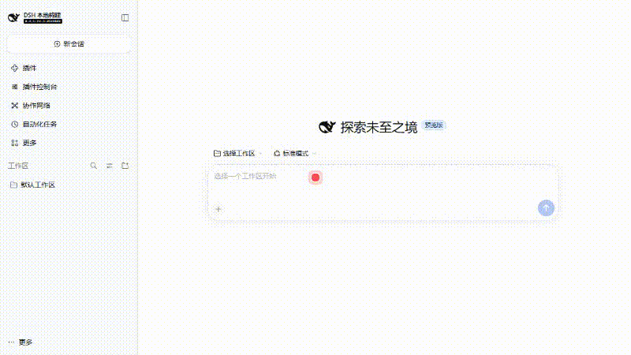
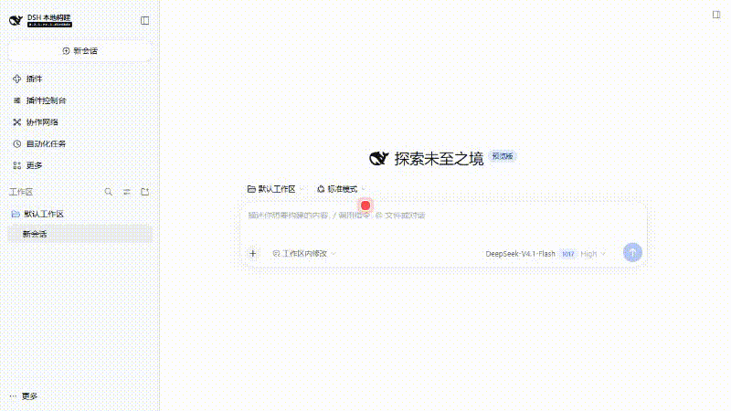

# dsh-util-plugs — DSH 工具箱插件集

A single install that adds eleven independently switchable plugins to DeepSeek Harness.

一次安装，为 DeepSeek Harness 增加 11 个可独立启用的插件。

> Release policy: **no tag and no release unless the user explicitly asks.** The release script requires `--confirm-release`.

> Version: 2026.11.17-13 · Release tag: 0.0.2 · Not yet published on npm; install from GitHub.

## 演示 / Demos





Clean-profile recordings with synthetic data; no live credentials or private project data. See [docs/demo/README.md](docs/demo/README.md) to regenerate.

## English

### What it adds

`dsh-util-plugs` gives DeepSeek Harness context awareness, cross-session messaging with a Web **Agent Hub**, shared boards/tasks, agent homes and teams, persistent agent memory, team coordination, workflows, a workbench overview, automatic file backups, safe host restart and a unified plugin console. Install once, then enable only the plugins you need in Settings → Plugins.

### What is new in 2026.11.17-13 (dev)

- **Queue default scoping**: `message_queue()` without `to` defaults to the caller; cross-recipient `to` is FORBIDDEN.
- **Web memory-forget gate**: `webUi.allowMemoryForget=true` + `confirm:"FORGET"` is required; the tool path remains gated by `allowForget`.
- **Ack/queue recipient checks**: `message_ack` denies third-party read receipts, and `message_queue({to})` refuses a target that is not the caller; `message_purge` stays disabled unless `allowPurge:true`.
- **Lease fencing and ownership**: one active lease per task, monotonic per-task `fencing_token`, owner-checked release, and `LEASE_CONFLICT` for a second claimant.
- **Send audit**: every accepted `message_send` appends one body-free row to `send-audit.jsonl` (actor, target, messageId, subject, bytes, sha256, flags, targetState).
- **Caller-scoped job reaper**: `job_reap` dry-runs by default; with `dryRun:false` + `confirm:"REAP"` it cancels only the caller's live jobs older than `staleMs` (default 15 min).
- **Memory forget operator gate**: `memory_forget` defaults to disabled (`allowForget:false`); when enabled it requires `confirm:"FORGET"` and appends an audit row to `memory/forget-audit.jsonl`.
- **Web body exposure default-off**: `webUi.exposeBody=false` by default; the Web Remote has no caller identity, so `messageBus.get` is body-redacted and list snippets are empty unless an operator opts in.
- **Default stale digest**: `bulletin_digest` applies `staleAfterHours=24` when no explicit SLA/`updatedBefore` is supplied, so stale active tasks are visible without a remembered SLA.
- **Archive ownership**: the manual-compaction reminder only resolves the caller's own `team/members/<role>/ARCHIVE_*.md`; foreign remembered paths are ignored and the fallback is the caller's role directory.
- **Artifact manifest**: `artifact_manifest` creates an immutable content-addressed manifest for a real artifact and can explicitly promote it to the single `artifacts/current.json` pointer; previous pointers are archived under `history/`.
- **Message-bus P0 hardening**: `message_read` now allows only the recipient or sender and returns FORBIDDEN for a missing/third-party caller; wake envelopes are typed `source.kind:'peer-message'` with sender identity; `message_bus_status` exposes `counts.unread`, and the pending reminder also fires for unread messages.
- **Task completion evidence**: `bulletin_task_complete` requires `{artifactId, sha256, checkResult}`; completion state and event are transactional, and `bulletin_task_update` cannot set `status=completed`.
- **Workbench self-report**: `workbench_status` reports the installed `dsh-util-plugs` bundle itself.

### What was new in 2026.11.17-1 (dev)

- **Agent Hub reliability**: the sidebar entry and panel are registered even before a conversation is selected; `remote.agentApartment` is resolved lazily, so a missing apartment row can no longer make the whole Agent Hub disappear.
- **Message delivery contract**: `message_send` reports `targetState` / `deliveryState` / `reasonCode` / `route`; `notFoundPolicy` defaults to `reject` (use `queueUndeliverable:true` or `notFoundPolicy:'queue'` for the old queueing behavior); `maxBodyChars` defaults to 100000.
- **Queue/audit paging**: `message_queue` and `message_audit` expose `offset`/`total`/`hasMore`; suppressed and undelivered rows are independently filterable.
- **Task safety**: `bulletin_task_update` uses CAS (`expectedRevision`), owner/operator checks and state-machine guards; boards/tasks support `query`/`offset`/`limit`/`total`; overview counts come from a full SQL aggregate, not the first page.
- **Meeting safety**: `meeting_post` / `meeting_finalize` require a participant or convener; legacy convener aliases must claim via an alias route; finalize is CAS-protected; a cross-process sidecar lock prevents concurrent post/finalize from losing bodies.
- **Apartment safety**: `apartment_migrate` / `apartment_restore` expose `APARTMENT_RESTART_REQUIRED` until the host restarts; restore validates `manifest.root`, removes stale files and applies the pending DB atomically.
- **Web UI**: meeting detail pages with “Load more”, read-only Web read receipts, and a single shared client for Agent Hub, restart and plugin console.
- **Clean-profile E2E**: `dsh e2e-ui2` (not `dsh web`) is documented and verified: boot entry, client asset, both sidebar entries and console errors are asserted.

### Install from GitHub

```sh
dsh plugin --profile web add github:wndd5603/dsh-util-plugs#0.0.2
```

The package is self-contained: all eleven runtime plugins live under `vendor/`; no npm publish is required.

### The eleven plugins

| Plugin | What it adds | Docs |
|---|---|---|
| `context-sentinel` | Context occupancy, per-turn `[ctx]` signal, archive reminders and optional guard rails. | [`vendor/context-sentinel/README.md`](vendor/context-sentinel/README.md) |
| `message-bus` | Local SQLite cross-session messaging, delivery/read state, strict-mode approval, queue/audit paging, `autoResume`, Agent Hub. | [`vendor/message-bus/README.md`](vendor/message-bus/README.md) |
| `bulletin-board` | Shared boards/tasks with owner/CAS, statuses, dependencies, search, pagination and digest. | [`vendor/bulletin-board/README.md`](vendor/bulletin-board/README.md) |
| `agent-apartment` | Agent homes/AGENTS.md, leases, teams/memberships, task roles, experience, root migration/backup/restore. | [`vendor/agent-apartment/README.md`](vendor/agent-apartment/README.md) |
| `agent-memory` | Persistent SQLite memory with remember/search/list/forget/status. | [`vendor/agent-memory/README.md`](vendor/agent-memory/README.md) |
| `team-bus` | Session network, aliases, meeting registry/permissions/CAS, shared pitfalls and coordination skills. | [`vendor/team-bus/README.md`](vendor/team-bus/README.md) |
| `agent-workflows` | Team Coordinator and Prompt Studio workflow tools. | [`vendor/agent-workflows/README.md`](vendor/agent-workflows/README.md) |
| `workbench-bundle` | Read-only `workbench_status()` overview and first-turn capability pointer. | [`vendor/workbench-bundle/README.md`](vendor/workbench-bundle/README.md) |
| `auto-backup` | Pre-write file snapshots, retention and `auto_backup_status()`. | [`vendor/auto-backup/README.md`](vendor/auto-backup/README.md) |
| `host-relaunch` | Two-step safe restart, Web header button and session resume. | [`vendor/host-relaunch/README.md`](vendor/host-relaunch/README.md) |
| `plugin-console` | Unified plugin console with cards, live configuration and extension contributions. | [`vendor/plugin-console/README.md`](vendor/plugin-console/README.md) |

Each plugin is independently switchable and configurable. The bundle version is 2026.11.17-13; individual plugins keep their own versions.

### Web UI

One shared client module powers three browser surfaces:

- **Agent Hub** — boards/tasks, agents/apartments, session/alias directory, messages, meetings and audit views in one sidebar page; works without an active conversation and shows a clear empty state.
- **Restart DSH** — a conversation-header button with PID suffix, typed confirmation and a block while sessions run or the safety lock is off.
- **Plugin Console** — plugin cards, live configuration, extension contributions and deep links to the native plugin manager.

All surfaces are UI-only for the model: agents read or request the same information through tools but cannot click panels.

### Memory recall

At the start of a session/task, use `memory_search`/`memory_list` to recall project memory; persist stable conclusions with `memory_remember`. The archive reminder also asks for this. See [`docs/MEMORY_RECALL_PROTOCOL.md`](docs/MEMORY_RECALL_PROTOCOL.md).

### Configuration and data

- Enable/disable and configure each plugin in Settings → Plugins.
- Local-first: no network calls and no credentials; SQLite/JSONL/backups stay under `$DSH_HOME` or the session workspace.
- Safe defaults: `allowPurge:false`, `notFoundPolicy:'reject'`, `allowRealRestart:false`.
- message-bus live fields: `strictMode`, `autoResume`, `maxBodyChars`, `notFoundPolicy`, `crossPermissionGuard`.
- See [`PRIVACY.md`](PRIVACY.md) for local data locations and cleanup.

### Compatibility and uninstall

- DeepSeek Harness `>=0.2.0 <0.3.0`; Node.js `>=24`; host restart is Windows-first.
- Remove the package from the profile or use the plugin manager. Data under `$DSH_HOME` is not deleted automatically.

### Release workflow

See [`docs/RELEASING.md`](docs/RELEASING.md): `dev` → `master` → tag → GitHub Release + `.tgz` asset via `node scripts/release.mjs`.

### Verify

```sh
npm run verify         # package structure and plugin entries
npm run verify:client  # shared client registration
```

### License

MIT © 2026 wndd5603

## 中文

### 这个安装包增加什么

`dsh-util-plugs` 一次安装，为 DeepSeek Harness 增加 **11 个**可独立启用的插件：上下文感知、带 Web **协作网络**的跨会话消息、公告栏/任务板、智能体公寓、持久记忆、团队协作、智能体工作流、工作台总览、自动备份、安全宿主重启和统一插件控制台。安装后在「设置 → 插件」中按需启用。

### 2026.11.17-13 新增

- **queue 默认 scope**：`message_queue()` 无 `to` 时默认只看调用者；跨收件人 `to` 仍 FORBIDDEN。
- **Web 记忆删除门**：Web Remote 需 `webUi.allowMemoryForget:true` + `confirm:"FORGET"`；工具路径仍由 `allowForget` 控制。
- **ack/queue 收件人校验**：`message_ack` 拒绝第三方读回执，`message_queue({to})` 拒绝非调用者目标；`message_purge` 仍默认禁用。
- **lease fencing / 归属**：每 task 唯一 active lease、per-task 单调 `fencing_token`、release 校验 owner、第二 claimant 返回 `LEASE_CONFLICT`；旧库自动加列。
- **发送审计**：每次成功 `message_send` 向 `send-audit.jsonl` 追加一行无正文审计（actor/target/messageId/subject/bytes/sha256/flags/targetState）。
- **调用者范围 job reaper**：`job_reap` 默认 dry-run；`dryRun:false` + `confirm:"REAP"` 才取消调用者自己超过 `staleMs`（默认 15min）的 live job。
- **记忆删除 operator 门**：`memory_forget` 默认禁用（`allowForget:false`）；开启后必须 `confirm:"FORGET"`，并写 `memory/forget-audit.jsonl` 审计。
- **Web 正文默认关闭**：`webUi.exposeBody=false`；Web Remote 没有调用者身份，默认 `messageBus.get` 正文脱敏、列表 snippet 为空，只有 operator 显式开启才返回正文。
- **默认 stale digest**：`bulletin_digest` 在未显式给 SLA/`updatedBefore` 时默认 `staleAfterHours=24`，无需记住 SLA 也能看到 stale 活跃任务。
- **归档归属**：手动压缩提醒只解析调用者自己的 `team/members/<role>/ARCHIVE_*.md`；记住的外部路径会被忽略，回退到本角色目录的最新归档。
- **工件清单**：`artifact_manifest` 为真实构建产物生成不可变 content-addressed manifest，可显式 promote 到唯一 `artifacts/current.json` 指针；旧指针归档到 `history/`。
- **消息总线 P0 加固**：`message_read` 只允许收件人或发件人读取，缺失/第三方 session 返回 FORBIDDEN；唤醒 envelope 使用 `source.kind:'peer-message'` 并带发送者身份；`message_bus_status` 增加 `counts.unread`，pending reminder 也对未读消息触发。
- **任务完成证据**：`bulletin_task_complete` 要求 `{artifactId, sha256, checkResult}`，状态与事件同事务；`bulletin_task_update` 不能再直接设 `status=completed`。
- **工作台自报**：`workbench_status` 会报告已安装的 `dsh-util-plugs` 自身。

### 2026.11.17-1 新增

- **协作网络稳定性**：即使还没选择会话，侧栏入口与面板也会注册；`remote.agentApartment` 改为惰性读取，apartment 未挂载不会再让整个协作网络消失。
- **消息投递契约**：`message_send` 返回 `targetState`/`deliveryState`/`reasonCode`/`route`；`notFoundPolicy` 默认 `reject`（旧行为用 `queueUndeliverable:true` 或 `notFoundPolicy:'queue'`）；`maxBodyChars` 默认 100000。
- **队列/审计分页**：`message_queue`、`message_audit` 提供 `offset`/`total`/`hasMore`；suppressed、undelivered 可独立过滤。
- **任务安全**：`bulletin_task_update` 增加 CAS（`expectedRevision`）、属主/operator 校验和状态机；任务板支持搜索/分页/total；overview 的 counts 改为全量 SQL 聚合。
- **会议安全**：`meeting_post`/`meeting_finalize` 仅 participant/convener 可用；legacy alias 需先 claim；finalize CAS；跨进程 sidecar 锁避免并发 post/finalize 丢正文。
- **公寓安全**：`apartment_migrate`/`apartment_restore` 后写操作返回 `APARTMENT_RESTART_REQUIRED`；restore 校验 `manifest.root`、清理多余文件、原子应用 pending DB。
- **Web 界面**：会议详情支持“加载更多”；Web 已读回执改为只读；同一 client 提供协作网络、重启与插件控制台。
- **clean profile E2E**：明确使用 `dsh e2e-ui2`（不是 `dsh web`），并断言 boot entry、client asset、双入口与 console errors。

### 从 GitHub 安装

```sh
dsh plugin --profile web add github:wndd5603/dsh-util-plugs#0.0.2
```

安装包自带全部运行代码（11 个插件位于 `vendor/`），无需先发布 npm。

### 11 个插件

| 插件 | 提供什么 | 文档 |
|---|---|---|
| `context-sentinel` | 上下文占用、每轮 `[ctx]` 提示、归档提醒与可选护栏。 | [`vendor/context-sentinel/README.md`](vendor/context-sentinel/README.md) |
| `message-bus` | 本地 SQLite 跨会话消息、投递/已读状态、严格模式审批、队列/审计分页、`autoResume`、协作网络。 | [`vendor/message-bus/README.md`](vendor/message-bus/README.md) |
| `bulletin-board` | 共享任务板：属主/CAS、状态、依赖、搜索、分页与 digest。 | [`vendor/bulletin-board/README.md`](vendor/bulletin-board/README.md) |
| `agent-apartment` | 智能体主目录/AGENTS.md、租约、团队/成员、任务角色、经验、根迁移/备份/恢复。 | [`vendor/agent-apartment/README.md`](vendor/agent-apartment/README.md) |
| `agent-memory` | 持久 SQLite 记忆：remember/search/list/forget/status。 | [`vendor/agent-memory/README.md`](vendor/agent-memory/README.md) |
| `team-bus` | 会话网络、别名、会议注册/权限/CAS、共享坑点与协作技能。 | [`vendor/team-bus/README.md`](vendor/team-bus/README.md) |
| `agent-workflows` | Team Coordinator 与 Prompt Studio 工作流工具。 | [`vendor/agent-workflows/README.md`](vendor/agent-workflows/README.md) |
| `workbench-bundle` | 只读 `workbench_status()` 总览与首轮能力提示。 | [`vendor/workbench-bundle/README.md`](vendor/workbench-bundle/README.md) |
| `auto-backup` | 写前文件快照、保留策略与 `auto_backup_status()`。 | [`vendor/auto-backup/README.md`](vendor/auto-backup/README.md) |
| `host-relaunch` | 两步安全重启、Web 顶栏按钮与会话恢复。 | [`vendor/host-relaunch/README.md`](vendor/host-relaunch/README.md) |
| `plugin-console` | 统一插件控制台：卡片、实时配置与扩展贡献。 | [`vendor/plugin-console/README.md`](vendor/plugin-console/README.md) |

每个插件项都可独立启用、禁用和配置。安装包版本为 2026.11.17-13，各插件保留自己的版本号。

### Web 界面

同一份 client 模块提供三个浏览器入口：

- **协作网络**：公告栏/任务板、智能体公寓、会话/别名目录、消息、会议与审计，统一在一个侧栏页面；无活动会话也有入口和空态。
- **重启 DSH**：会话顶栏按钮，PID 后四位、输入确认词；有会话运行或安全锁关闭时禁用。
- **插件控制台**：插件卡片、实时配置、扩展贡献与原生插件管理器深链。

这三个界面都只供人操作：智能体可通过工具读取或请求同样信息，但不能点击面板。

### 配置与数据

- 在「设置 → 插件」中逐个启用/禁用/配置。
- 本地优先：无网络请求、无凭据；SQLite、JSONL 审计与备份保存在 `$DSH_HOME` 或会话工作区。
- 安全默认：`allowPurge:false`、`notFoundPolicy:'reject'`、`allowRealRestart:false`。
- message-bus 实时字段：`strictMode`、`autoResume`、`maxBodyChars`、`notFoundPolicy`、`crossPermissionGuard`。
- 本地数据位置与清理见 [`PRIVACY.md`](PRIVACY.md)。

### 兼容与卸载

- 兼容 DeepSeek Harness `>=0.2.0 <0.3.0`、Node.js `>=24`；宿主重启优先支持 Windows。
- 从 profile 移除安装包，或使用插件管理器卸载。`$DSH_HOME` 下的数据不会自动删除。

### 自检

```sh
npm run verify         # 安装包结构与插件项
npm run verify:client  # 共享 client 注册
```

### 许可证

MIT © 2026 wndd5603
